# Vision Action Platform

6일차에 학습한 **6개 동작 인식 모델(Random Forest)을 다시 학습하지 않고** 웹 서비스로 연결한 프로젝트입니다.

---

> 코드를 처음 읽는다면 [CODE_GUIDE.md](CODE_GUIDE.md)부터 보세요 — 파일을 실행 순서대로 설명합니다.

## 1. 프로젝트 소개

회원이 브라우저에서 **영상 업로드** 또는 **IP Webcam(휴대폰 카메라 8초 수집)** 을 골라 `AI 분석 시작`을 누르면, 영상 속 사람마다 어떤 동작을 했는지 예측해 보여 주는 서비스입니다.
분석 요청은 즉시 작업 ID로 응답하고, 실제 추론은 Celery Worker가 FastAPI AI 서버에 맡겨 백그라운드에서 처리합니다.
사용자는 **Track ID별 예측 동작 · Confidence · 판단 불확실 여부**를 확인하고, 관리자는 Django Admin과 `/dashboard/` 차트로 전체 기록을 봅니다.

| 지원 동작 (6개) | `bend_return` · `leg_raise_lower` · `walk_turn_walk` · `drink_return` · `sit_stand` · `wave` |
|---|---|
| 입력 | 영상 업로드 (mp4·avi·mov·mkv·webm, 100MB 이하) / IP Webcam 8초 수집 |
| 결과 | 사람(Track)별 Action · Confidence · 판단 불확실(< UNCERTAIN_THRESHOLD, 기본 0.4) · 처리 시간 |

> 학습하지 않은 동작도 모델은 6개 중 하나를 출력합니다. 예측 Label을 정답이나 위험행동 판정으로 보지 말고 Confidence와 함께 확인해야 합니다.

---

## 2. 실행 방법

> 처음부터 끝까지 따라 하는 상세 설치·실행 가이드: [docs/install_guide.html](docs/install_guide.html) (브라우저로 열기) — zip을 새로 풀어 그대로 실행해 확인한 순서입니다.

```bash
git clone <this-repo> && cd vision_action_platform
cp .env.example .env              # DB 비밀번호, ALLOWED_CAMERA_URLS(휴대폰 IP) 수정
docker compose up --build -d      # django · fastapi · celery · redis · postgres
docker compose exec django python manage.py createsuperuser   # 관리자 계정
```

- **모델 파일**: `ai_service/models/`에 포함되어 있어 따로 준비할 필요가 없습니다 (아래 6번 참고).
- **마이그레이션**: django 컨테이너가 시작할 때 `migrate → collectstatic → runserver` 순서로 자동 실행됩니다.
  직접 실행하려면 `docker compose exec django python manage.py migrate`.
- **IP Webcam**: 휴대폰 IP Webcam 앱을 켜고 `.env`에 `ALLOWED_CAMERA_URLS=phone1=http://<휴대폰 IP>:8080/video` 형태로 등록합니다. 사용자는 화면에서 `phone1` 같은 이름만 고르고 URL은 입력할 수 없습니다.

| 화면 | 주소 |
|---|---|
| 사용자 화면 (AI 분석) | http://localhost:8000/analyses/ (`/`로 들어와도 이동) |
| 회원가입 · 로그인 | http://localhost:8000/accounts/signup/ · http://localhost:8000/accounts/login/ |
| 관리자 대시보드 (`is_staff`) | http://localhost:8000/dashboard/ |
| Django Admin | http://localhost:8000/admin/ |
| FastAPI 문서 (개발용) | http://localhost:8001/docs |

**테스트**

```bash
cd backend
uv venv --python 3.12 .venv && VIRTUAL_ENV=.venv uv pip install -r requirements.txt
USE_SQLITE=1 .venv/bin/python manage.py test        # 29 tests
```

---

## 3. 전체 아키텍처

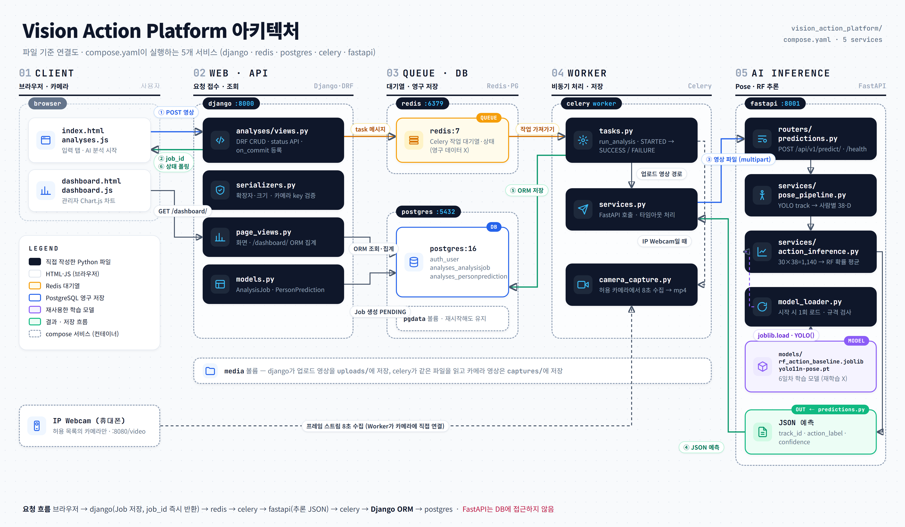

`compose.yaml`이 실행하는 서비스 5개: **django**(UI·API·ORM) · **redis**(작업 대기열) · **postgres**(영구 저장) · **celery**(비동기 처리·결과 저장) · **fastapi**(AI 추론).
FastAPI는 DB에 접근하지 않고 JSON만 돌려주며, 저장은 Celery Worker가 **Django ORM**으로 합니다. 서비스끼리는 `localhost`가 아니라 서비스 이름(`postgres`, `redis`, `fastapi`)으로 통신합니다.

<details><summary>Mermaid 버전</summary>

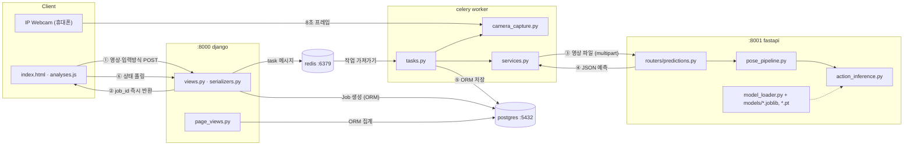
</details>

---

## 4. DB 설계 (ERD)

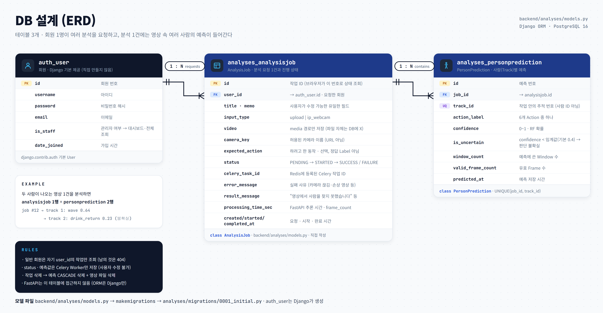

| 테이블 | 저장하는 것 | 작성 위치 |
|---|---|---|
| `auth_user` | 회원 (아이디, 비밀번호 해시, 관리자 여부) | Django 기본 제공 |
| `analyses_analysisjob` | 분석 요청 1건: 입력 방식, 영상 경로, 상태, Celery task ID, 에러, 처리 시간 | `backend/analyses/models.py` |
| `analyses_personprediction` | 작업 안의 사람(Track)별 예측: Action, Confidence, 판단 불확실 | `backend/analyses/models.py` |

두 사람이 나오는 영상 1건을 분석하면 `analysisjob` 1행에 `personprediction` 2행이 연결됩니다. `track_id`는 그 작업 안에서만 의미 있는 추적 번호입니다.

**작업 상태 표기**: `PENDING → STARTED → SUCCESS / FAILURE`(과제 md의 후보이자 Celery 기본 상태 이름)로 전체를 통일했고, 화면에는 `대기 → 처리 중 → 완료 / 실패`로 보입니다. 단계별 개발가이드의 `PENDING → PROCESSING → COMPLETED / FAILED`와 같은 의미입니다. 화면의 '영상 수집 · AI 분석'은 별도 필드 `stage`로 보여 주는 진행 단계입니다.

<details><summary>Mermaid 버전</summary>

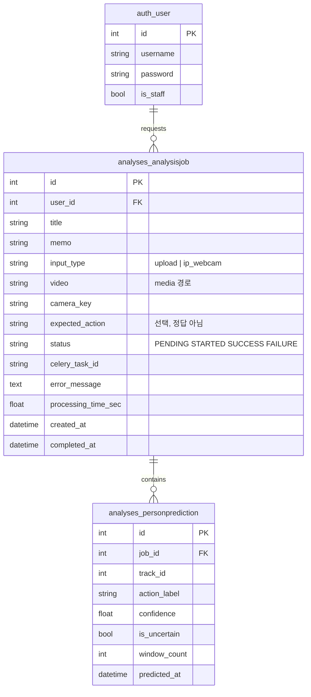
</details>

---

## 5. AI 분석 버튼 구현 흐름

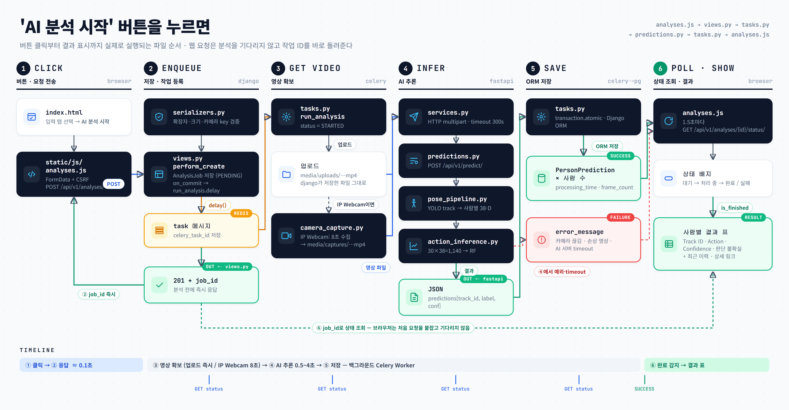

| 단계 | 파일 | 하는 일 |
|---|---|---|
| ① | `static/js/analyses.js` | FormData + CSRF로 `POST /api/v1/analyses/` |
| ② | `analyses/serializers.py` → `analyses/views.py` | 입력 검증 → `AnalysisJob` 저장(PENDING) → `transaction.on_commit`으로 `run_analysis.delay()` → **작업 ID 즉시 반환** |
| ③ | `analyses/tasks.py` (+ `camera_capture.py`) | STARTED, 업로드 영상 경로 확보 또는 IP Webcam 8초 수집 |
| ④ | `analyses/services.py` → `ai_service/routers/predictions.py` → `services/pose_pipeline.py` → `services/action_inference.py` | 영상 전송 → YOLO Pose Tracking → 사람별 30 Step × 38 = 1,140 Feature → Random Forest |
| ⑤ | `analyses/tasks.py` | Django ORM으로 `PersonPrediction` 저장 + SUCCESS, 오류·timeout은 FAILURE + `error_message` |
| ⑥ | `static/js/analyses.js` | 1.5초마다 `GET /api/v1/analyses/{id}/status/` → 완료되면 사람별 결과 표 |

<details><summary>Mermaid 버전</summary>

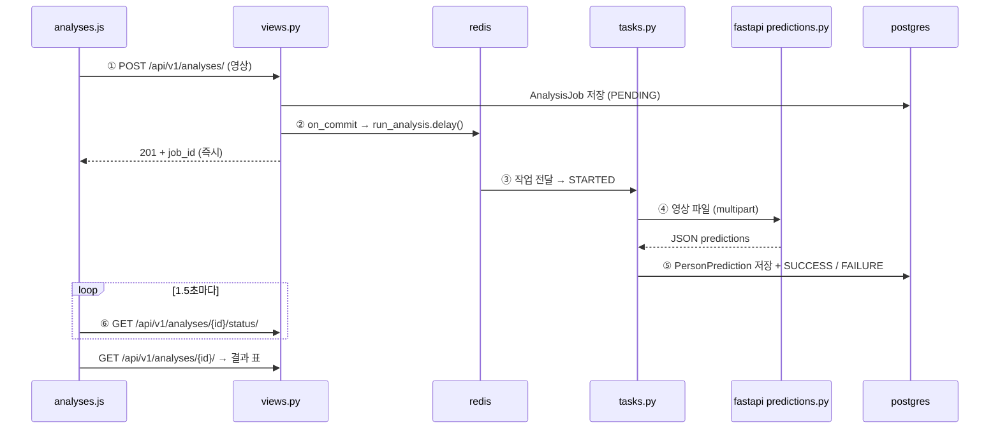
</details>

### 5-1. AI 추론 파이프라인 (함수 단위)

위 그림이 "어떤 **파일**이 어떤 순서로 동작하나"라면, 아래 그림은 FastAPI 안에서 "어떤 **함수**가 어떤 순서로 영상을 숫자로 바꾸고 예측하나"를 보여 줍니다. 실제 함수 이름 그대로입니다.

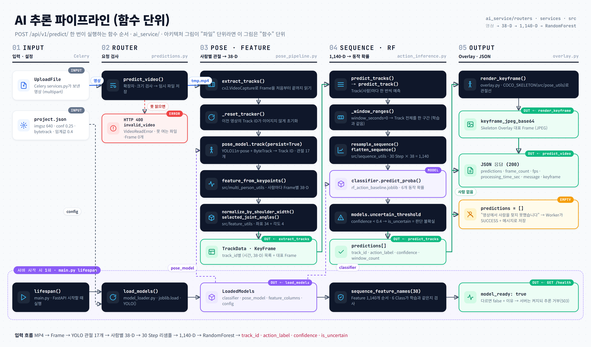

| 단계 | 함수 (파일) | 하는 일 |
|---|---|---|
| 서버 시작 | `lifespan()` → `load_models()` (main.py · model_loader.py) | joblib·JSON·YOLO를 한 번 로드, `sequence_feature_names(30)`으로 1,140개 Feature 순서 검사 |
| 요청 | `predict_video()` (routers/predictions.py) | 확장자·크기 검사 → 임시 파일 → 못 읽으면 400 |
| 자세 | `extract_tracks()` → `pose_model.track(persist=True)` (services/pose_pipeline.py) | Frame마다 YOLO Pose + ByteTrack → Track ID별 관절 17개 |
| 특징 | `feature_from_keypoints()` → `normalize_by_shoulder_width()` · `selected_joint_angles()` (src/) | 사람별 Frame마다 38-D (좌표 34 + 각도 4) |
| 시퀀스 | `predict_track()` → `resample_sequence()` · `flatten_sequence()` (services/action_inference.py, src/) | Track 전체를 30 Step으로 → 1,140-D |
| 예측 | `classifier.predict_proba()` → `uncertain_threshold` | 6개 동작 확률 중 최대값 = 동작·신뢰도, 0.4 미만은 판단 불확실 |
| 출력 | `render_keyframe()` (services/overlay.py) → JSON | Skeleton Overlay JPEG + `predictions[]` |

---

## 6. 사용한 모델과 입력 형식

**모델 (`ai_service/models/`, 6일차 결과물을 그대로 복사, 재학습 없음)**

| 파일 | 원본 경로 (`subject10_pose_action/`) | 역할 |
|---|---|---|
| `rf_action_baseline.joblib` (365KB) | `artifacts/day06/` | Random Forest 300 trees, 6개 Class |
| `rf_feature_columns.json` | `artifacts/day06/` | 학습 Feature 1,140개 이름과 순서 |
| `rf_training_info.json` | `artifacts/day06/` | `sequence_steps=30`, Class 목록 |
| `yolo11n-pose.pt` (6.2MB) | 루트 | COCO 17 Keypoint Pose 추출 |

- 서버 시작 시 `model_loader.py`가 한 번 로드하고 **Feature 수(1,140) · 순서 · 6개 Class가 학습 때와 같은지 검사**합니다. 다르면 `/health`가 `model_ready=false`와 원인을 보여 줍니다.
- 다른 모델로 바꾸려면 같은 파일명의 4개 파일을 담은 폴더를 `MODEL_DIR` 환경변수로 지정합니다.
- 기존 코드 재사용: `ai_service/src/`에 `pose_utils · feature_utils · sequence_utils · realtime_utils · multi_person_utils`를 복사했습니다.

**FastAPI 입력·출력**

| 엔드포인트 | 입력 | 출력 |
|---|---|---|
| `GET /health` | 없음 | `model_ready`, `classes`, `feature_count`, `sequence_steps`, `model_version`, `uncertain_threshold` |
| `POST /api/v1/predict/` (= `/predict/video`) | 영상 파일 (multipart) | `predictions[track_id, action_label, confidence, is_uncertain, window_count]`, `frame_count`, `processing_time_sec`, `message`, `keyframe_jpeg_base64`(Skeleton Overlay) |

- 영상 → YOLO Pose Tracking(ByteTrack) → Track ID별 38-D Feature(정규화 좌표 34 + 관절 각도 4) → Track 전체를 **30 Step으로 리샘플** → 1,140-D → Random Forest. 6일차 학습과 같은 방식입니다.
- 손상 파일·지원하지 않는 확장자는 400 + 사유, 사람이 없으면 200 + 빈 `predictions` + `영상에서 사람을 찾지 못했습니다`.
- IP Webcam 수집 시간: **8초** (`CAMERA_CAPTURE_SECONDS`). 연결 10초, 3초 동안 Frame이 없으면 끊김으로 판단합니다.
- IP Webcam 미리보기: 브라우저는 `GET /api/v1/cameras/{key}/snapshot/`(로그인 필요)만 0.5초마다 호출하고, Django가 허용된 카메라의 `/shot.jpg`를 대신 받아 전달합니다. 카메라 주소는 브라우저에 노출되지 않습니다.
- **판단 불확실 기준**: `UNCERTAIN_THRESHOLD` 환경변수 (기본 0.4). 모델 출력값은 그대로 두고 표시만 바뀝니다.
- **Skeleton Overlay (추가 점수)**: FastAPI가 사람이 가장 많이 잡힌 대표 Frame에 관절·Track ID·예측을 그려 JPEG로 돌려주고, Celery Worker가 `media/keyframes/`에 저장해 결과 화면에 보여 줍니다.

**10일차 데이터 파일명 주의**: `a02_s07_e01.mp4`처럼 `a02 · a10 · a12 · a14 · a18`로 시작하는 파일은 이 모델의 A001~A006과 **다른 번호 체계**입니다 (MSR Action3D 계열 명명으로 추정, 확인 안 됨). 그래서 화면의 `수행하려는 동작(expected_action)`은 선택 항목이고, 정답 Label로 쓰지 않습니다.

---

## 7. 실행 결과와 검증

> ①②④⑤ 캡처는 **Docker Compose 5개 컨테이너**(Postgres · Redis · Celery Worker · FastAPI CPU 추론)에서 찍은 실제 결과이고, ③ IP Webcam 캡처는 로컬 실행에서 찍었습니다. Docker E2E: T02·T04·T05(POST 22~137ms에 작업 ID 즉시 반환)·T06·T07·T08·T09·T10(compose down/up 후 데이터 유지) 통과.

**① 정상 분석** — `01_정상_sit_stand.mp4`(S01 앉았다 일어나기) 업로드 → Track #1 `sit_stand` 66.7%, 수행하려는 동작과 일치, Skeleton Overlay 표시

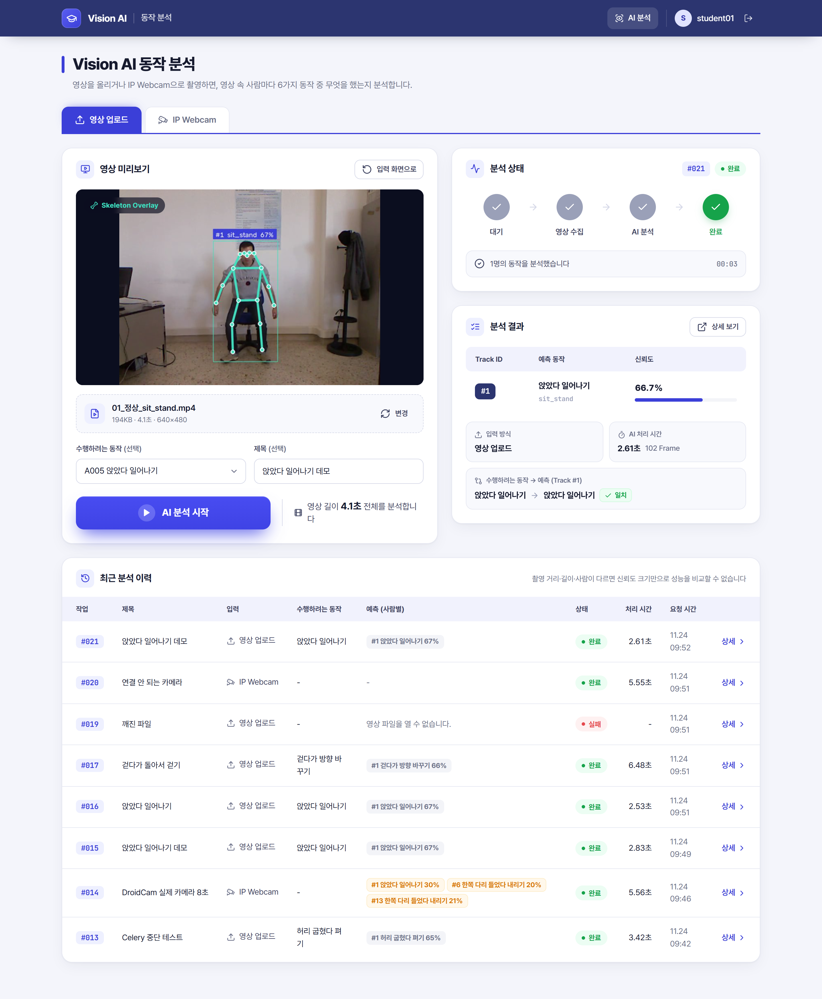

**② 오류·실패** — `04_깨진파일.mp4`(랜덤 바이트) 업로드 → AI 분석 단계에서 실패, "영상 파일을 열 수 없습니다." 저장

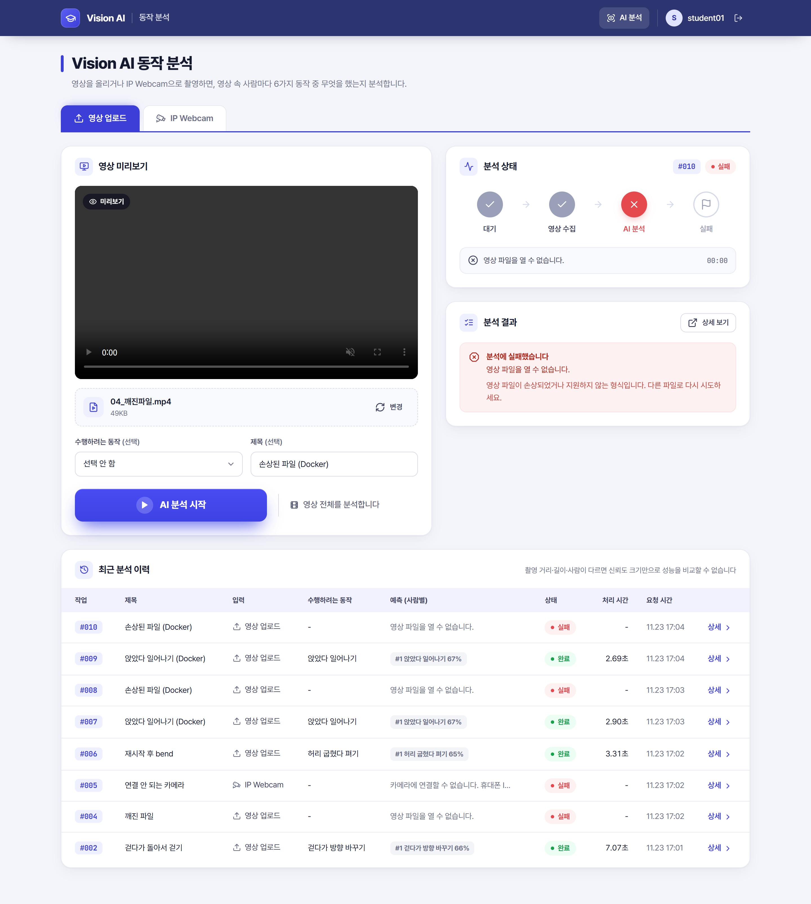

**③ IP Webcam** — 허용된 카메라 `phone1` 실시간 미리보기 → 분석 완료 (캡처에서는 휴대폰 대신 로컬 영상을 카메라로 등록해 촬영) · 연결 안 되는 카메라 `phone2`는 실패 사유 저장

| 실시간 미리보기 | 분석 완료 | 카메라 연결 실패 |
|---|---|---|
| 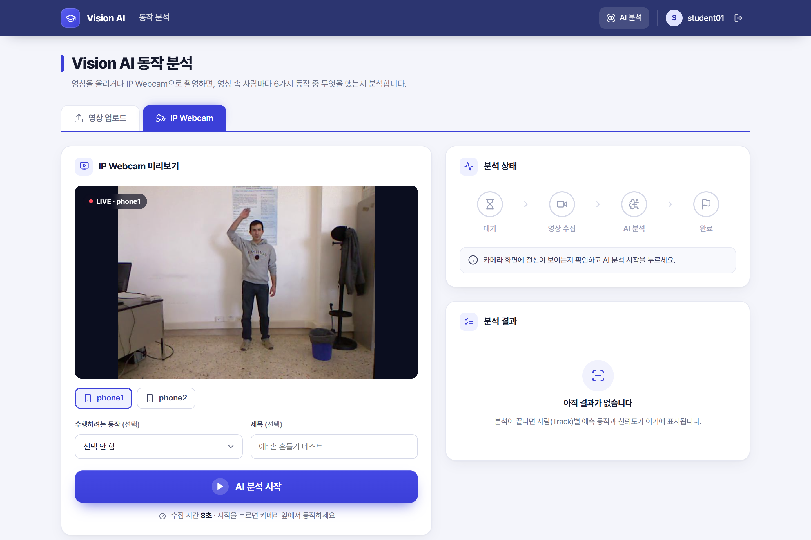 | 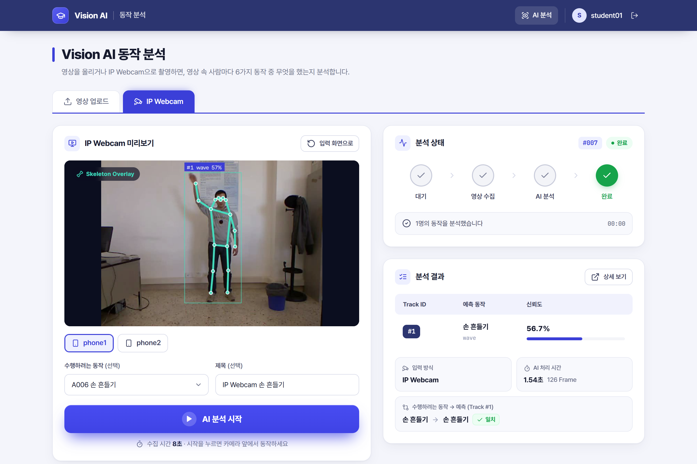 | 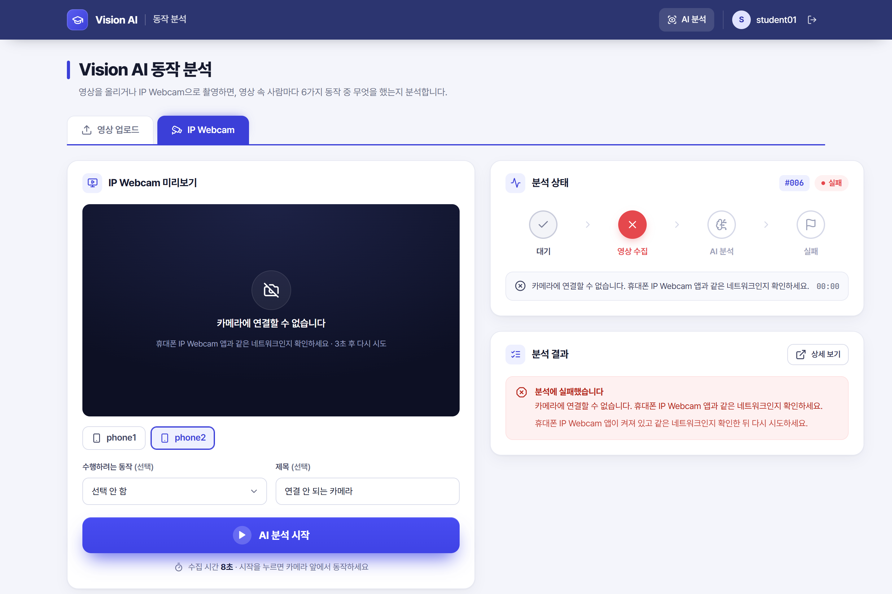 |

**④ 관리자 대시보드** — `/dashboard/` (staff 전용): 동작별 예측 건수(가로 막대), 작업 상태별 건수(도넛), 입력 방식 비율, 평균 처리 시간, 최근 작업

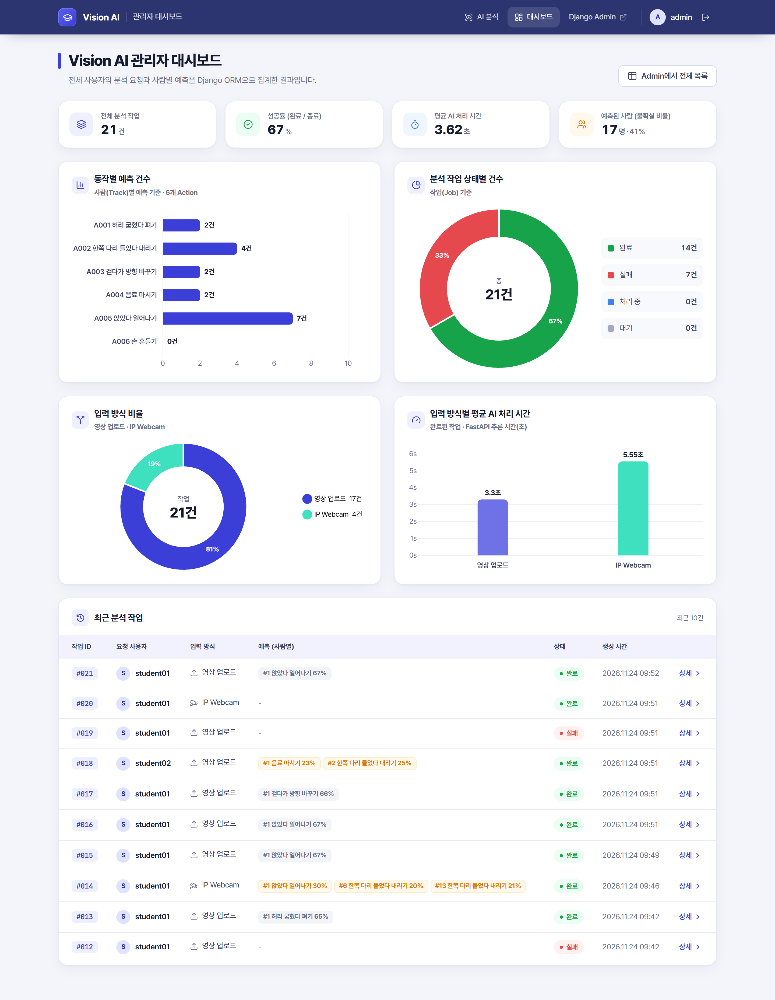

**⑤ Django Admin** — 분석 작업 목록 (상태·입력 방식·동작 필터, 사용자 검색, 사람별 예측 요약)

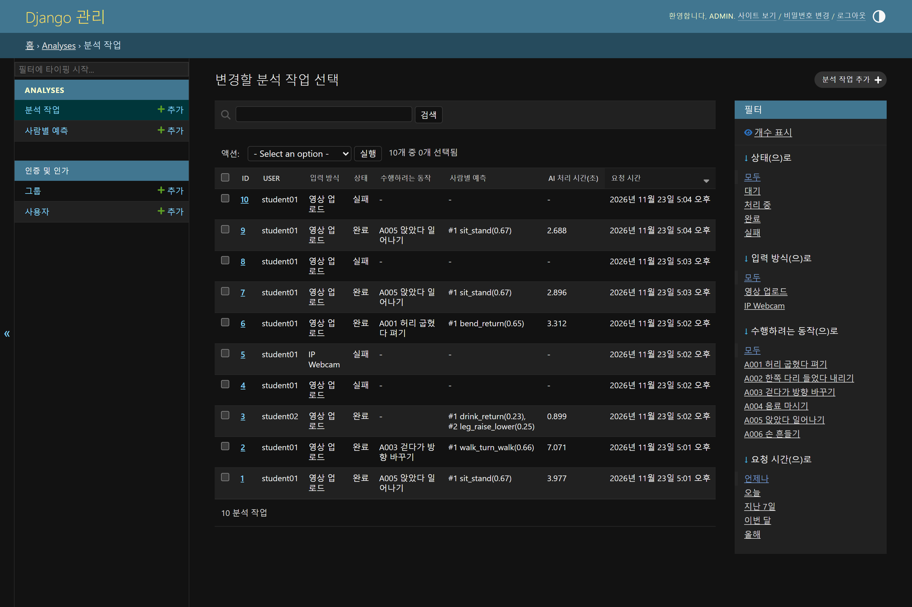

| 로그인 | 분석 상세 (Overlay · 원본 · 메모 수정 · 삭제) |
|---|---|
| 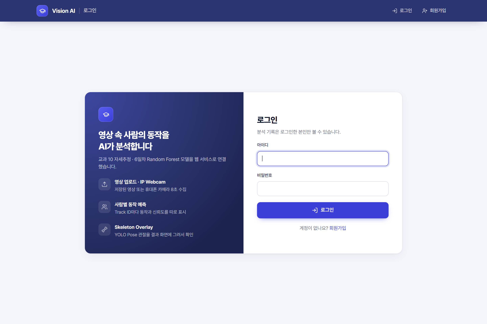 | 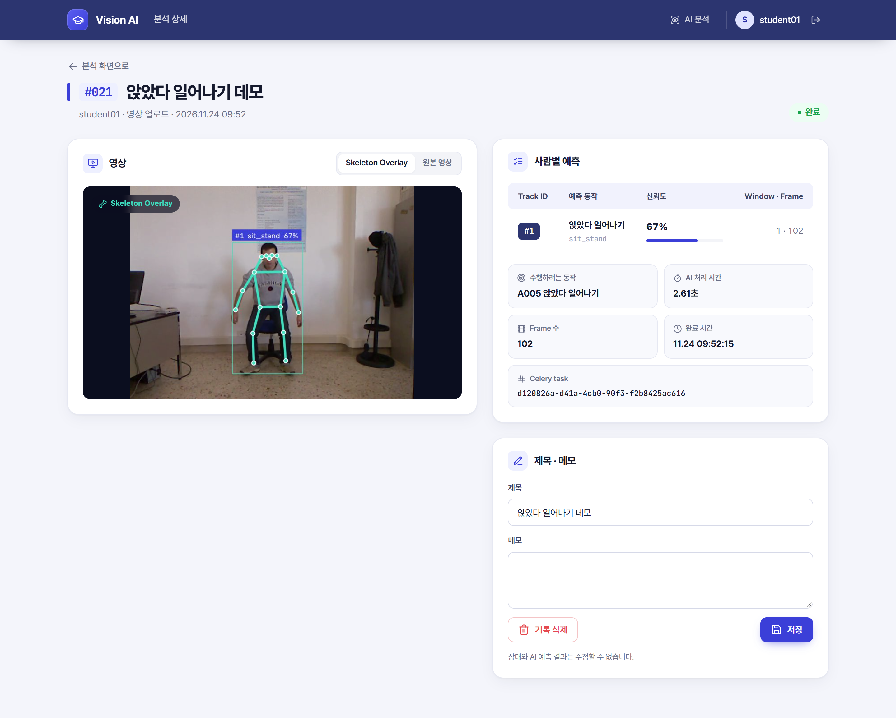 |

**모바일(390px)** — 같은 화면이 휴대폰 폭에서도 가로 스크롤 없이 보입니다.

| 분석 화면 | 관리자 대시보드 |
|---|---|
| 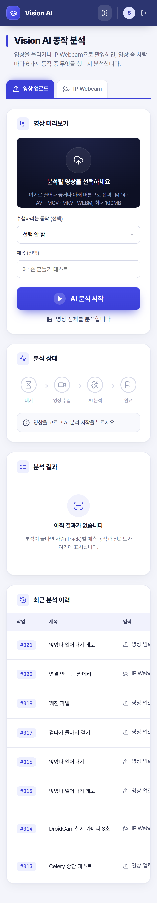 | 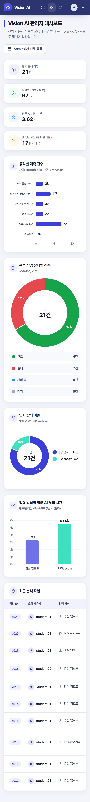 |

**기능 테스트 (과제 T01~T10)**

| 테스트 | 근거 | 결과 |
|---|---|---|
| T01 모델 불러오기 | `GET /health` → 6 Class · `feature_count` 1140 · `sequence_steps` 30 · `model_ready` true | ✅ Docker |
| T02 영상 업로드 | `01_정상_sit_stand.mp4` → SUCCESS, sit_stand 66.7% ([캡처](docs/screenshots/03_index_success.png)) | ✅ Docker |
| T03 IP Webcam | 실제 휴대폰(DroidCam) 8초 수집 → 243 Frame · 1280×720 · 30fps → FastAPI → SUCCESS | ✅ Docker |
| T04 사람별 결과 | SBU 악수 영상 → 작업 1건에 Track #1·#2 예측 2행 | ✅ Docker |
| T05 비동기 처리 | 요청 직후 22~151ms에 201 + 작업 ID(PENDING), 분석은 Worker가 진행 | ✅ Docker |
| T06 영구 저장 | 새로고침·재조회해도 같은 작업·예측 (테스트 `test_create_upload_job_returns_id_and_saves_predictions`) | ✅ Docker · 테스트 |
| T07 CRUD 권한 | student02가 student01 작업 조회·수정·삭제 → 모두 404 | ✅ Docker · 테스트 |
| T08 관리자 | 일반 회원 `/dashboard/` → 302, admin → 200 · 차트 숫자 = `psql` 직접 집계 ([캡처](docs/screenshots/08_dashboard.png)) | ✅ Docker |
| T09 예외 처리 | 손상 파일 → "영상 파일을 열 수 없습니다." · 카메라 꺼짐 → "카메라에 연결할 수 없습니다…" · 수집 중 미리보기 → 409 "사용 중" ([캡처](docs/screenshots/04_index_failure.png)) | ✅ Docker |
| T10 Docker | `docker compose down` → `up` 후 작업·예측·Overlay 파일 그대로, 새 분석도 정상 | ✅ Docker |

**단계별 개발가이드 수동 검증 (Docker)**

| 확인 | 결과 |
|---|---|
| FastAPI 컨테이너 중지 후 분석 요청 | 3.7초 뒤 FAILURE, "AI 서버에 연결할 수 없습니다. fastapi 서비스가 실행 중인지 확인하세요." |
| Celery 컨테이너 중지 후 분석 요청 | PENDING(대기)으로 유지 → Celery 다시 시작하자 1.6초 뒤 처리 시작, SUCCESS |
| 대시보드 숫자 vs `psql` 직접 조회 | 동작별·상태별 건수 모두 일치 |
| Swagger `http://localhost:8001/docs` | 200, `/api/v1/predict/` · `/predict/video` · `/health` 표시 |
| 중복 아이디 회원가입 | "해당 사용자 이름은 이미 존재합니다." 표시, 계정 추가 안 됨 |

> **알려진 한계 (신뢰도)**: 6일차 모델은 **동작마다 학습 영상이 1개뿐**이라 데이터가 부족합니다. 그래서 학습에 쓴 영상도 신뢰도가 60~70%대에서 멈추고, 새 사람·새 환경은 20~40%로 "판단 불확실"이 됩니다. 숫자를 부풀리지 않고 그대로 보여 주며, 동작별 학습 영상을 더 모아 다시 학습하면 개선할 수 있습니다.

**해결한 오류 예시**

- **증상**: 테스트에서 분석 작업이 계속 `FAILURE`로 저장됨 → **확인**: 에러 로그에 `ModuleNotFoundError: No module named 'packaging'` (Celery 5.7이 작업 실행 시 import) → **수정**: `backend/requirements.txt`에 `packaging` 추가 → **검증**: 테스트 통과(현재 29개), 실제 FastAPI 호출 E2E SUCCESS.
- **증상**: 학습에 쓴 `S01 walk_turn_walk`(10.6초)가 `leg_raise_lower 0.20`으로 틀림 → **확인**: 5초 Window로 잘라 예측했는데, 6일차 학습은 **Clip 전체**를 30 Step으로 리샘플함 → **수정**: 기본값을 Track 전체 리샘플(`window_seconds=0`)로 변경 → **검증**: `walk_turn_walk 0.663`, S03 정답 6/6.
- **증상**: 실제 휴대폰(DroidCam)으로 분석하면 사람이 여러 명으로 잡히고 신뢰도 20~30% → **확인**: 저장된 Overlay를 보니 영상이 90° 누워 있었고, DroidCam은 연결을 1개만 받아 미리보기와 수집이 서로 막음("DroidCam is Busy") → **수정**: `.env`의 `CAMERA_ROTATE`로 회전, 분석 시작 시 브라우저 미리보기를 멈추고 수집이 끝나면 다시 시작, 사용 중이면 409 "사용 중" 안내 → **검증**: 8초 243 Frame 수집 SUCCESS, 수집 중 미리보기는 409로 안내.
